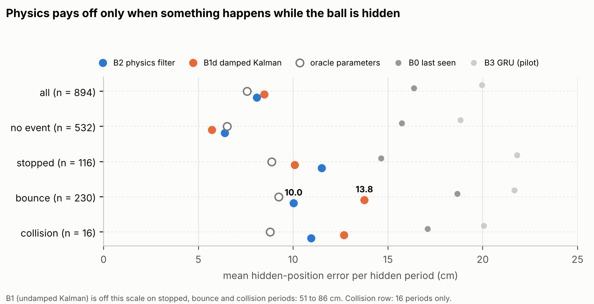

# occlusion-memory

**Learning persistent physical states under occlusion.** Can an explicit, uncertainty-aware belief over each object's state, learned from RGB and actions, track hidden objects better than a learned latent memory? And does calibrated uncertainty about where a hidden object is improve decisions?

The research spec and the Stage 0 pilot report live in [`docs/`](docs/):

- [`docs/SPEC.md`](docs/SPEC.md): hypotheses H1–H3, frozen methodological rules, baselines, data protocol, metrics and stage gates.
- [`docs/PILOT_REPORT.md`](docs/PILOT_REPORT.md): Stage 0 pilot, with the benchmark generator, six methods, results, limitations and changes before Stage 1.

## Status

**Stage 0 (pilot) is done; Gate 1 passes with conditions.** The benchmark separates methods, but most of the headroom is in hidden periods where the ball bounces or collides.



| Finding (1,000 eval episodes, 894 hidden periods, one seed) | Value |
|---|---|
| Mean hidden-position error: damped Kalman (B1d) vs physics particle filter (B2) | 8.5 vs 8.1 cm; difference +0.4 cm [−0.1, +0.9] |
| B2's advantage on bounce/collision periods | 3.6 cm [2.3, 5.1], i.e. 26% |
| Extra gain from true physical parameters (oracle) | 0.5 cm [0.1, 1.0] |
| Collisions while hidden | 16 of 894 periods (1.8%) |
| 90%-region coverage: B1d / B2 | 86% / 47% (B2 is accurate but overconfident) |
| Bounce/collision periods where B2's particles go bimodal | 51% |

Next, before any confirmatory run:

1. Make events while hidden common: at least 40% of hidden periods with an event, at least 10% with a collision.
2. Rebuild the learned baseline (B3): hidden-weighted loss, 10k episodes, scene information.
3. Re-run B2 with more particles or tempering.
4. Decide the image resolution: 64×64 vs 96×96, or larger balls.

## What is here

| Path | Purpose |
|---|---|
| `gen.py` | Procedural MuJoCo benchmark: walled 1 m tabletop, 1–2 balls, screens (occlude only) and blocks (occlude and collide), per-episode camera, ray-cast visibility and hidden-region maps, event labels. `SEED_RANGES` fixes disjoint seeds per split. |
| `baselines.py` | B0 last-seen, B1 constant-velocity Kalman, B1d damped Kalman with wall reflection, B2 MuJoCo particle filter (prior-sampled parameters, negative evidence from the hidden-region map), oracle-parameter filter, B3 GRU with Gaussian output. |
| `make_pilot.py` | Generate pilot episodes: `python make_pilot.py <start> <n> <render 0/1>`. |
| `pilot_run.py` | Tune on the fit half, train the GRU, run every method on the eval half. |
| `pilot_analyze.py` | Hidden-period labels, errors, coverage, episode-clustered bootstrap, power estimate, multimodality test. |
| `make_figures.py` | Figures in `figures/`. |
| `results/pilot_summary.json` | Every number in the pilot report. |
| `results/pilot_intervals.csv` | One row per hidden period: label, duration, per-method error, coverage and region area. |


## Reproduce the pilot

CPU only, about 45 minutes on 4 cores. Rendering uses OSMesa by default (`apt-get install libosmesa6`); set `MUJOCO_GL=egl` to render on a GPU instead.

```bash
pip install -r requirements.txt
```

```bash
python make_pilot.py 0 200 1 & python make_pilot.py 200 600 0 & python make_pilot.py 800 600 0 & python make_pilot.py 1400 600 0 & wait
```

```bash
python pilot_run.py 4
```

```bash
python pilot_analyze.py && python make_figures.py
```

Episode files (`data/`) and per-episode predictions (`results/*.pkl`) are not committed: they regenerate exactly from their seeds with MuJoCo 3.8.1.

## Ground rules

These rules are frozen before any confirmatory run; see the spec.

1. Simulator ground truth never enters a model or planner at test time.
2. Every comparison uses identical episodes, observations and action budgets.
3. Prediction and decision performance are evaluated separately.
4. The proposed model must beat B1 and a strong learned baseline, not merely last-seen tracking.
5. A deterministic-belief ablation is required.
6. Pilot episodes (seeds 9,000,000–9,099,999) are never reused for confirmatory splits.

This project is separate from the Real2Sim/VLA reconstruction-fidelity study. The one planned link comes after Stage 4: a LIBERO task whose target is hidden.
