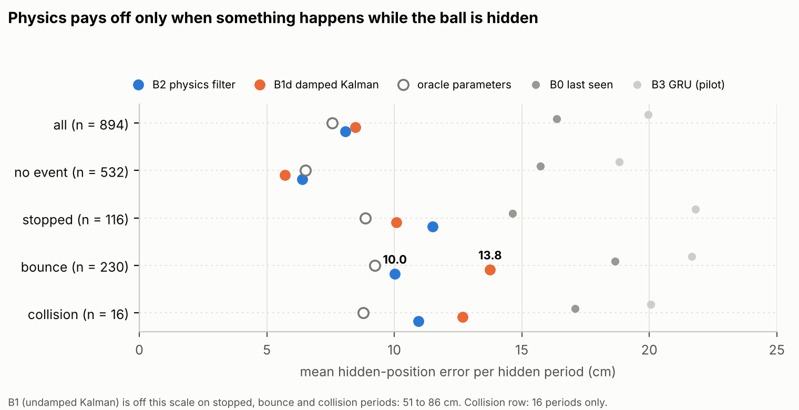

# Stage 0 Pilot Report — Learning Persistent Physical States Under Occlusion

2026-11-13 · Living version: <https://claude.ai/artifact/3c4Yrg1KEZRNa4oNyqx5Wg>

## Summary

Gate 1 passes, with conditions. The benchmark clearly separates methods, but a damped Kalman filter that knows the arena walls already matches a physics-engine filter overall. Physics helps only when the ball bounces or collides while hidden. Three changes are needed before Stage 1.

- **Overall accuracy:** mean hidden-position error is 8.5 cm for the damped Kalman filter (B1d) and 8.1 cm for the physics-engine particle filter (B2). The difference is +0.4 cm [−0.1, +0.9], not significant.
- **Bounce and collision periods:** B2 is better by 3.6 cm [2.3, 5.1], or 26%. Knowing the true mass and friction improves B2 by only 0.5 cm more.
- **Collisions while hidden** are rare: 16 of 894 hidden periods (1.8%).
- **The pilot GRU is not yet a fair learned baseline.** It tracks visible balls to 0.65 cm but misses hidden ones by 21.6 cm (median).
- **Calibration does not follow from accuracy.** B2's 90% regions cover only 47% of true hidden positions; B1d's cover 86%.
- **A single Gaussian belief is not enough.** In 51% of bounce and collision periods, B2's particles split into two separated clusters.

The pilot used noisy positions of visible balls rather than images, and one seed. It tests memory and dynamics, not perception.

## What the pilot tested

The pilot asked one feasibility question from the spec: does the benchmark leave headroom between simple tracking and physics-aware prediction? It measured task difficulty, runtime and variance, not which thresholds would favour a new model.

- **Data:** 2,000 episodes from the reserved pilot seed range (9,000,000 onward), which no confirmatory split will reuse. Even-numbered episodes (1,000) were used for tuning and training, odd-numbered ones (1,000) for evaluation.
- **Inputs:** every method received the same noisy positions of visible balls (Gaussian noise, σ = 1 cm, seeded per episode) and nothing while a ball was hidden. Simulator state was never an input at test time.
- **Scoring:** a ball's hidden period is a run of consecutive hidden frames. Each period is labelled by what happened during it: collision with the other ball, bounce off a wall or block, stopped by friction, or nothing. The evaluation half contains 894 such periods.

| Method | What it is | Tuned on the fit half |
|---|---|---|
| B0 last seen | Hidden ball stays at its last measurement; uncertainty grows linearly | Growth rate 0.5 m/s |
| B1 Kalman | Constant-velocity Kalman filter | Process noise q = 0.1 |
| B1d damped Kalman | B1 plus velocity decay and reflection off the arena walls; knows nothing of blocks or the other ball | q = 0.01, decay 1.0 /s, wall restitution 0.6 |
| B3 GRU | Recurrent network (128 units) with Gaussian output, trained on the fit half | Trained 3,000 steps, best validation checkpoint |
| B2 physics filter | 100 particles, each a MuJoCo copy of the scene; mass, friction and restitution drawn from the prior; also penalises particles predicting a visible ball while it is hidden | None; priors only |
| Oracle parameters | B2 with the true physical parameters and 32 particles; a reference, not a competitor | None |

B1d was added because the spec requires a simple physics tracker as a real competitor. B2 and the oracle know the scene geometry (walls, blocks, screens); B1d knows only the walls; B3 knows none of it.

## Benchmark generator

The generator produces 8 s episodes (80 frames at 10 Hz) of one or two balls on a 1 m walled tabletop with one or two occluders. Two thirds of episodes contain a hidden period of at least 3 frames.

- **Scene:** balls have a 2–4 cm radius and free joints, so they slide, then roll. Occluders are either *screens*, floating 10–15 cm above the table and never touching anything, or *blocks*, 20–30 cm tall, which collide.
- **Camera:** 64×64 RGB, elevation 50–70°, azimuth ±15°. Its distance is fitted per episode so that the whole arena stays in frame.
- **Sampled per ball:** mass 0.1–1 kg, sliding friction 0.05–0.4, rolling friction 0.0002–0.002, restitution about 0.1 or about 0.6, launch speed 0.3–1.5 m/s.
- **Launch:** ball 0 is aimed at a point deep inside the region the camera cannot see, found by ray casting. Ball 1, when present, moves in a random direction.
- **Visibility:** 9 rays are cast from the camera to points on each ball. A ball counts as visible if at least 3 reach it unobstructed. This agrees with segmentation pixel counts on 99.4% of frames, and does not depend on image resolution.

**Hidden periods in the evaluation half:**

| What happened while hidden | Periods |
|---|---|
| Nothing | 532 |
| Bounce off a wall or block | 230 |
| Stopped by friction | 116 |
| Collision with the other ball | 16 |
| **Total** | **894** |

Durations were 1–2 frames (168 periods), 3–5 (303), 6–15 (204) and 16 or more (219). 205 periods (23%) were still hidden at the last frame, mostly balls that stopped under a screen.

**Problems the pilot caught in the generator:**

| Problem | Symptom | Fix |
|---|---|---|
| Contact too stiff for the 2 ms step | Balls launched up to 256 m after a bounce | Measured restitution per setting; a 20 ms contact time constant with damping 0.1 (restitution about 0.6) or 1.0 (about 0.1) |
| Balls spawning inside blocks | Speeds of 12–26 m/s | Rejection sampling of start positions |
| Camera framing | Arena in a thin band, then its near edge cut off | Distance fitted per episode to keep every wall in frame |
| Occlusion too rare | Only 48% of episodes had any hidden frame | Aim at cells deep inside the hidden region; taller blocks |
| Visibility depended on resolution | Small, distant balls counted as hidden | Ray-based visibility |

## Results

The physics filter's advantage over simple tracking is confined to periods with an event. Its estimates are the most accurate but the worst calibrated.

### Accuracy

*Source: `results/pilot_summary.json` · 894 hidden periods, one seed, 2026-11-12. Regenerate with `python make_figures.py`.*

Paired differences per hidden period, with 95% bootstrap intervals clustered by episode:

| Comparison | All periods | Bounce or collision | 6 frames or longer |
|---|---|---|---|
| B1 − B1d (damping and walls help) | +21.6 cm [18.5, 24.9] | +37.4 cm [28.4, 47.5] | +44.4 cm [38.3, 50.1] |
| B1d − B2 (physics helps) | +0.4 cm [−0.1, +0.9] | +3.6 cm [2.3, 5.1] | +1.1 cm [0.0, 2.2] |
| B2 − oracle (true parameters help) | +0.5 cm [0.1, 1.0] | +0.9 cm [0.0, 1.8] | +1.3 cm [0.5, 2.1] |
| B3 − B2 (learned vs physics) | +11.9 cm [11.1, 12.7] | +11.5 cm [9.9, 13.0] | +11.4 cm [10.1, 12.6] |

On periods of 16 frames or more (219), errors were 13.2 cm for B1d, 11.4 cm for B2 and 9.0 cm with true parameters.

### Calibration

| Method | 50% region covers | 90% region covers | Median 90% region area (cm²) |
|---|---|---|---|
| B0 last seen | 54% | 91% | 3,993 |
| B1 Kalman | 66% | 92% | 909 |
| B1d damped Kalman | 53% | 86% | 184 |
| B3 GRU (pilot) | 40% | 85% | 3,520 |
| B2 physics filter | 24% | 47% | 53 |
| Oracle parameters | 19% | 38% | 28 |

Coverage uses each method's Gaussian summary (mean and covariance). For the particle filters that summary hides any multimodality, so their poor coverage reflects both too-narrow particle clouds and the Gaussian approximation.

### Multimodality

In 126 of the 246 bounce and collision periods (51%), B2's particles split into two separated clusters on at least one frame: 19% of the frames in those periods. The test was 2-means on the weighted particles, both clusters holding at least 10% of the weight, and centres more than 3 cm and more than 3 within-cluster spreads apart.

### Cost and sample size

- **Generation:** 0.8 s per episode per core. **B2:** 5.1 s per episode with 100 particles; the oracle filter 1.5 s with 32. The other methods take under 3 ms.
- **Sample size:** detecting a 20% error reduction against B1d at 80% power needs about 124–185 paired periods. This assumes the paired spread between B1d and B2 carries over to a new model.

## Interpretation and limitations

As generated, most hidden periods are dynamically simple, so a tuned linear tracker that knows the walls is a hard baseline. The case for a learned, physics-aware belief rests on two things: periods with events, and calibration.

**What the results support:**

- **Headroom exists but is concentrated.** Physics beats simple tracking by 26% on bounces and collisions, and by nothing measurable otherwise.
- **Unknown parameters are a minor error source.** True mass and friction improve the physics filter by only 0.5 cm. The remaining error must come from elsewhere, for example imperfect initial state or the particle approximation. Neither was tested.
- **Accuracy and calibration are separate problems.** The most accurate method has the worst coverage. Too few particles is the likely cause, also untested.
- **Multimodal beliefs are common after events.** This supports testing a particle version of the proposed model alongside the Gaussian one.

**Limitations:**

- **No perception.** Methods received noisy positions, not images. At 64×64 a real detector will do worse, so Stage 1 errors will include perception error.
- **One seed and a weak learned baseline.** The GRU was under-trained on hidden frames and had no scene geometry. Its 11.9 cm gap to the physics filter says nothing about learned models in general.
- **The physics filter is an upper reference.** Its motion model is the same simulator and its priors match the generator's ranges exactly. With misspecified physics it would do worse.
- **Collision results are anecdotal:** 16 periods.
- **The multimodality test is a heuristic**, run on an overconfident filter's particles.
- **Censored periods are included.** 23% of periods are still hidden at the last frame; their errors are averaged in like the rest.
- **Coverage uses Gaussian summaries,** which understates how well a multimodal particle cloud could do.

## Changes before Stage 1 and open decisions

Three changes are needed before confirmatory work. All stay within what the spec's freeze rules allow, which is ranges and counts only; the primary metric is unchanged.

1. **Make events while hidden common.** In about half the episodes, send ball 1 on a collision course into the hidden region, and place blocks inside hidden regions. Target: at least 40% of hidden periods with an event and at least 10% with a collision. Verify with a 200-episode rerun from the pilot seed range.
2. **Rebuild the learned baseline.** Weight hidden frames in the GRU's loss, train it on 10,000 episodes, and give it the same scene information as the other methods (RGB in Stage 1). It must at least match B1d on periods with no event before it counts as strong.
3. **Re-run the physics filter with more particles or tempering,** beside the 100-particle version, to separate real overconfidence from too few particles.

**Proposed numbers, to fix after the generator check:**

- **Minimum important improvement:** 20% lower hidden-position error than the best of B1d and the rebuilt GRU. The physics filter reaches 26% on event periods, so 20% means approaching engineered physics without a hand-built simulator.
- **Calibration tolerance:** 90% regions should cover 85–95% in distribution. B1d already reaches 86%.
- **Test size:** 1,000 episodes per test split. That gives about 900 hidden periods against the roughly 190 needed.

**Open decision: image resolution.** At 64×64 the balls cover 2–13 pixels, so Stage 1 risks becoming a perception test rather than a memory test. The options are 96×96, larger balls, or keeping 64×64. The question is open in the research spec.

## Reproduction

The whole pilot runs on a 4-core CPU with no GPU in about 45 minutes. The code lives in the `occlusion-memory` repository, with this report and the research spec as Markdown under `docs/`.

| Step | Command | Time on 4 cores |
|---|---|---|
| Install | `pip install -r requirements.txt`; on a machine without a GPU, set `MUJOCO_GL=osmesa` | a few minutes |
| Generate pilot data | `python make_pilot.py 0 200 1` (keeps RGB), plus `python make_pilot.py 200 600 0`, `800 600 0` and `1400 600 0` in parallel | about 10 min |
| Tune, train and run all methods | `python pilot_run.py 4` | about 34 min |
| Analyse | `python pilot_analyze.py` | about 1 min |

- **Outputs:** `results/pilot_summary.json` holds every number in this report; `results/pilot_intervals.csv` holds one row per hidden period.
- **Seeds:** the pilot uses 9,000,000–9,001,999 from the reserved pilot range. Confirmatory ranges are fixed in `gen.py` (`SEED_RANGES`) and do not overlap it.
- **Data:** episode files are not stored in the repository. They regenerate exactly from their seeds with the same MuJoCo version (3.8.1).
