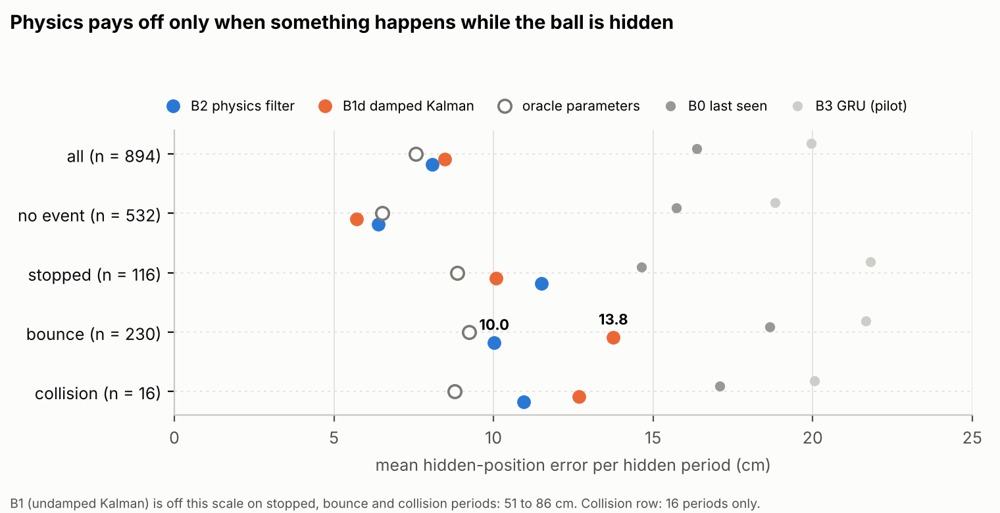
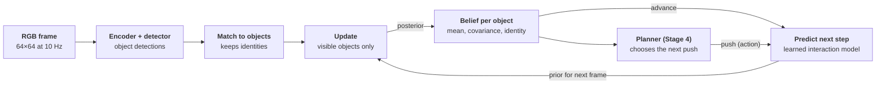
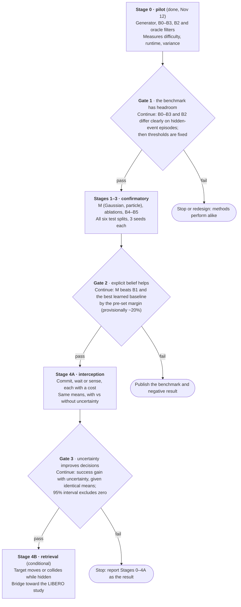

# Learning Persistent Physical States Under Occlusion — Research Specification

2026-11-12 · Living version: <https://claude.ai/artifact/AoCnbG2rPWkXE45TyjVC3j>

## Question and hypotheses

The project tests one claim. An explicit, uncertainty-aware belief over each object's state, learned from RGB and actions, should predict hidden objects better than a strong learned latent dynamics model. That gain should then carry over to decisions. Each hypothesis below has a pre-registered test and can fail.

- **H1, prediction.** On held-out initial conditions, an explicit per-object belief predicts hidden positions with lower error than two baselines: a recurrent latent world model of equal size, and a constant-velocity Kalman tracker fed the same detections. It also predicts reappearance time and place better. The gap should grow with occlusion length and with collisions during occlusion.
- **H2, calibration.** The belief's 50% and 90% predictive regions cover the true hidden position close to nominal on in-distribution tests, within a tolerance set after the pilot. Under longer occlusions and parameter shift, we report how far coverage degrades and whether uncertainty grows while the object is hidden. Over-coverage is not required.
- **H3, decisions.** In an interception task the agent chooses to commit, wait or sense, each with a cost or deadline. Given identical mean predictions, a planner that also receives calibrated uncertainty succeeds more often than one that does not. This separates the value of uncertainty from the value of accuracy.

**Scope.** Simulated tabletop (MuJoCo) with 1–3 rigid objects, one or two static occluders and one 64×64 RGB camera whose viewpoint varies by episode. Actions are pushes.

**Not in scope.** Pixel generation, Gaussian splatting, large pretrained video models and real robots.

**Privileged information.** Simulator state is used only as a training target and for evaluation. It is never a test-time input.

## What is frozen now and what the pilot sets

The rules are frozen before the one-day pilot. The numbers are set after it, before any confirmatory run. The pilot measures feasibility, difficulty, runtime and variance; it is never used to find thresholds that favour M.

**Methodological rules, frozen now:**

1. Simulator ground truth never enters a model or planner at test time.
2. Every comparison uses identical episodes, observations and action budgets.
3. Prediction and decision performance are evaluated separately.
4. M must beat B1 and a strong learned baseline, not merely last-seen tracking.
5. A deterministic-belief ablation is required, to show whether uncertainty itself helps.
6. Pilot episodes are never reused: confirmatory splits come from a separate seed range.

| Frozen before the pilot | Set after the pilot, before confirmatory runs |
|---|---|
| Hypotheses H1–H3 | Numerical success thresholds |
| Baselines and the fairness rules | Position-error tolerance that counts as practically meaningful |
| Primary metric and its comparison | Minimum important improvement (provisional target: about 20% lower hidden-position error) |
| What the pilot may change: episode length, occlusion and parameter ranges, episode counts | Episode counts, from measured variance |
| Confirmatory split definitions and seed ranges | Seeds, evaluation code and decision rules, recorded with a commit hash |

The final report will state that thresholds were calibrated on pilot data.

## Stage 0 pilot results

Gate 1 passes, but the headroom sits in one place. A damped Kalman filter that knows the walls already matches the physics-engine filter, except when the ball bounces or collides while hidden. Three fixes to the generator and baselines are needed before Stage 1.

**Setup.** 2,000 episodes from the reserved pilot seed range: 1,000 for tuning and training, 1,000 for evaluation, giving 894 occlusion intervals. Every method received identical noisy positions (σ = 1 cm) of visible balls and nothing while they were hidden. This was a measurement oracle with no images yet, so the pilot tests memory and dynamics, not perception. One seed.

B1d is a simple physics tracker added because you asked for one as a real competitor. It is a Kalman filter with velocity decay and wall reflection, both fitted on the tuning half.

*Stage 0 pilot, 2026-11-12 · `results/pilot_summary.json` · 894 hidden periods, one seed. Full analysis in [PILOT_REPORT.md](PILOT_REPORT.md).*

| Method | 50% region covers | 90% region covers | Median 90% region area (cm²) |
|---|---|---|---|
| B0 last seen | 54% | 91% | 3,993 |
| B1 Kalman | 66% | 92% | 909 |
| B1d damped Kalman | 53% | 86% | 184 |
| B3 GRU (pilot) | 40% | 85% | 3,520 |
| B2 physics filter | 24% | 47% | 53 |
| Oracle parameters | 19% | 38% | 28 |

**Findings:**

- **Headroom.** Overall, B1d and B2 tie: B1d − B2 = +0.4 cm [−0.1, +0.9]. On bounce and collision intervals B2 is better by 3.6 cm [2.3, 5.1], or 26%. True parameters add only 0.5 cm over B2, so unknown mass and friction are a minor error source in this design.
- **Collisions while hidden are rare:** 16 of 894 intervals (1.8%). That is too few to test interaction modelling.
- **B3 is not yet a strong baseline.**
  - It tracks visible balls well (0.65 cm median error) but fails on hidden frames (21.6 cm).
  - Hidden frames are only 17% of its training signal, and it lacks the scene geometry that B1d and B2 use.
  - Beating it now would mean beating a strawman, which rule 4 forbids.
- **Calibration is not automatic.** The most accurate method, B2, is the most overconfident: its 90% regions cover only 47% of hidden positions. B1d covers 86%.
- **Multimodality is common.** In 51% of bounce and collision intervals, B2's particles split into two separated clusters on at least one frame (19% of those frames). This supports the particle variant of M.
- **Episode length.** 8 s works.
  - 23% of intervals are still hidden at the end, mostly balls that stopped under a screen.
  - 219 intervals last 16 frames or more, enough for the long-occlusion split.
- **Cost.**
  - Generation takes 0.8 s per episode per core; B2 takes 5.1 s with 100 particles.
  - Detecting a 20% error reduction against B1d needs about 120–190 paired intervals at 80% power. That is ample overall, but only about 250 event intervals arise per 1,000 episodes.

**Before Stage 1.** These changes stay within what the freeze rules allow (ranges and counts only); the primary metric is unchanged.

1. **Raise the share of events while hidden.** In about half the episodes, send ball 1 on a collision course into the hidden region, and place blocks inside hidden regions. Target: at least 40% of intervals with an event and at least 10% with a collision. Check with a 200-episode rerun from the pilot seed range.
2. **Rebuild B3 as a fair learned baseline.** Weight hidden frames in its loss, train it on 10,000 episodes, and give it the same scene information as the other methods (RGB in Stage 1). It must at least match B1d on no-event intervals before it counts as strong.
3. **Report B2 with more particles, or with tempering,** beside the 100-particle version, so its overconfidence is not an artefact of particle count.

**Proposed numbers to fix after the generator check:**

- **Minimum important improvement:** 20% lower hidden-position error than the best of B1d and a rebuilt B3. B2, with full physics, achieves 26% on event intervals, so 20% means approaching engineered physics.
- **Calibration tolerance:** 90% regions should cover 85–95% in distribution. B1d already reaches 86%.
- **Test size:** 1,000 episodes per test split.

**Open decision: image resolution.** At 64×64 the balls cover only 2–13 pixels, so Stage 1 could become a perception problem rather than a memory problem. Moving to 96×96, or to 3–5 cm balls, would fix that. Resolution is not among the settings the pilot may change, so it needs your call.

## Related work and what remains open

Every ingredient of the hypothesis already exists in some paper, so the contribution must be the controlled comparison, not the architecture. The table gives each work's own description; "not stated" means the abstract does not say.

| Work | Persistent state | Dynamics | Uncertainty | Decisions |
|---|---|---|---|---|
| [PERSIST](https://www.microsoft.com/en-us/research/publication/beyond-pixel-context-windows-neural-world-simulators-with-persistent-3d-state-2/) (Garcin et al., ICML 2026) | Latent 3D scene: environment, camera, renderer | Not stated for unseen objects | Not stated | Interactive generation; no decision evaluation |
| [P3Sim](https://arxiv.org/abs/2606.27575) (Lee et al., CVPR 2026) | Persistent scene memory around a 7B transformer over RGB, depth and flow | Learned | Distributions over scene variables | Conditioned on local actions; no decision evaluation |
| [PersistGS](https://arxiv.org/abs/2606.03479) (Ramlal & Zelek, CVPR Workshops 2026) | Per-object Gaussians plus collision meshes | Differentiable rigid-body simulator; friction and velocity fitted before occlusion | None: one trajectory | None |
| [MemoBench](https://arxiv.org/abs/2606.27537) (Chen et al., 2026) | Benchmark: 360 clips where objects change while out of view | n/a | n/a | n/a; tests 8 video generators |
| [ADEPT](https://www.mit.edu/~k2smith/publication/adept) (Smith et al., NeurIPS 2019) | Coarse object representations through occlusion | Probabilistic physical simulation | Particle filter | None; scored on surprise at impossible events |
| [Differentiable particle filters](https://arxiv.org/abs/1805.11122) (RSS 2018); [Recurrent Kalman Networks](https://arxiv.org/abs/1905.07357) (ICML 2019) | Filtered state | Learned end to end | Explicit (particles; Kalman covariance) | None |
| [DreamerV3](https://arxiv.org/abs/2301.04104) (Hafner et al., 2023) | Recurrent stochastic latent | Learned | Stochastic latents, not object-level | Yes, via imagined rollouts |
| [SlotFormer](https://arxiv.org/abs/2210.05861) (Wu et al., ICLR 2023) | Object slots | Learned transformer | None explicit | Used for planning |
| [Learning to Track with Object Permanence](https://arxiv.org/abs/2103.14258) (Tokmakov et al., 2021) | Recurrent memory supervised on invisible-object labels | None | None | None |

Two benchmark results shape the protocol:

- [Physion](https://arxiv.org/abs/2106.08261): object-centric vision models beat non-object-centric ones. Models given physical state do best, so extracting state is the bottleneck.
- [Kang et al.](https://arxiv.org/abs/2411.02385) (ICML 2025): video models trained on simulated motion generalize in distribution but fail out of distribution, matching the nearest training case. Our tests must therefore be out of distribution by design.

**What remains open:**

- **Matched comparison.** No work found compares an explicit object belief with a learned latent memory under the same supervision, model size, occlusion lengths beyond training and physical-parameter shift.
- **Calibration.** Calibration of hidden-object predictions is rarely reported. PersistGS predicts one deterministic trajectory; ADEPT keeps particles but is scored only on surprise.
- **Decisions.** No work found tests whether a calibrated hidden-object belief improves decisions made while the object is hidden. DreamerV3 and SlotFormer plan, but not under occlusion.

All of this comes from abstracts and project pages, checked on 2026-11-12. The full papers need a read before we claim any gap in writing.

## Baselines

The proposed model must beat the strongest row below, not the weakest. All learned models get the same RGB encoder, the same training data and supervision, within ±10% of each other's parameter count, and an equal tuning budget of 20 trials each.

| ID | Baseline | What it is | What beating it would show |
|---|---|---|---|
| B0 | Last seen | Hidden object stays where it was last detected | Any dynamics help at all |
| B1 | Constant-velocity Kalman filter | Linear motion model on the shared detector's outputs; noise tuned on validation | Learned dynamics beat simple tracking (your Kalman test) |
| B2 | Physics-engine particle filter (ADEPT/PersistGS-style) | MuJoCo as motion model inside a particle filter; mass and friction estimated from pre-occlusion frames, never read from the simulator | Learned dynamics beat engineered physics, at least when its model is wrong |
| B3 | Recurrent latent world model (DreamerV3-style) | Stochastic recurrent latent with action input and state-prediction heads | Explicit object belief beats a strong generic latent memory |
| B4 | Object-centric learned dynamics (SlotFormer-style) | Per-object state with a learned interaction model, deterministic | Uncertainty matters beyond object structure |
| B5 | Learned permanence tracker (Tokmakov-style) | Recurrent memory trained on hidden-object labels, no physics | Physics structure matters beyond memory |

**Proposed model (M).** Per-object Gaussian belief, with mean and covariance over position and velocity plus an identity slot. A learned interaction-aware motion model sits inside a differentiable filter; measurement updates come only from visible frames. Implementation follows the differentiable particle filter and Recurrent Kalman Network line.

**Ablations of M:**

- M without covariance (deterministic belief), to test whether the uncertainty matters.
- M with a generic MLP motion model instead of the interaction-aware one, to test whether physics structure matters.
- M with ground-truth measurements of visible objects. This separates perception error from memory error.

**Representation check.** A hidden collision can split the posterior into several distinct outcomes, which a single Gaussian cannot represent. The pilot measures how often B2's particle posterior is multimodal on hidden-collision episodes. If it often is, a particle version of M joins as a primary variant: the same learned motion model inside a differentiable particle filter. The Gaussian-versus-particle comparison then becomes a finding in its own right.

**References that are not competitors:**

- **Oracle filter:** the true simulator with true parameters inside a particle filter. It is a near-perfect floor, because the simulator is deterministic.
- **Blind prior:** the dataset's average trajectory. It gives the worst reasonable error.

**Supervision.** Training may use simulator state for both visible and hidden objects, as auxiliary targets for every learned model. That is privileged at training time only. A self-supervised track with pixel and next-frame losses only is a stretch goal, not part of the first decision.

## Data-generation protocol

One MuJoCo arena is generated procedurally, with every test split out of distribution on a single, named axis. Hidden-object uncertainty comes only from what the camera cannot see: unobserved mass and friction, and events behind occluders. The simulator itself is deterministic.

**Scene.** A 1 m × 1 m walled tabletop.

- **Objects:** 1–3 rigid spheres or cylinders, radius 2–4 cm.
- **Occluders, in two kinds:**
  - *Screens* float above the table. They hide objects but never touch them, which separates occlusion from interaction.
  - *Blocks* both hide objects and collide with them.
- **Camera:** one oblique camera, 64×64 RGB at 10 Hz. Its pose is sampled per episode within ±15° azimuth and ±10° elevation of a nominal view. Episodes are provisionally 8 s (80 frames), so a 4 s occlusion still has visible history before it and a reappearance after it. The pilot sets the final length (6–8 s).
- **Actions:** a planar impulse on one object at t = 0, with an optional second push mid-episode, so dynamics are action-conditioned.

**Sampled per episode** (training ranges; values are first guesses to be tuned in a pilot):

- mass 0.1–1.0 kg
- sliding friction 0.05–0.4
- restitution low or high, through MuJoCo contact parameters
- push speed 0.2–1.5 m/s
- occluder size and position

Each episode is labelled by what happened while the object was hidden: nothing, a wall bounce, an object–object collision, or stopping by friction. Metrics are reported per label.

**Recorded, never given to models at test time:** positions, velocities, per-frame visible fraction (from segmentation), contact events and the sampled parameters.

| Split | Size | What differs from training |
|---|---|---|
| Train | 10,000 episodes | 1–2 objects; occlusion 0.3–1.5 s |
| Validation | 1,000 | Same distribution, new seeds; used only for tuning |
| Test: in distribution | 1,000 | New initial conditions |
| Test: long occlusion | 1,000 | Occlusion 1.5–4 s |
| Test: parameter shift | 1,000 | Friction 0.4–0.8, mass 1–2 kg |
| Test: more objects | 1,000 | 3 objects |
| Test: identity | 500 | Identical-looking objects whose paths cross behind an occluder |
| Test: new viewpoint | 1,000 | Camera 25–40° from the nominal azimuth, outside the training range |

At 8 s per episode the training set would take about 10 GB compressed, close to this machine's 11 GB of free disk. Episodes are therefore regenerated from seeds on demand rather than archived.

## Proposed model

*Proposed model M, one filter step per frame. Hidden objects get no measurement: only prediction moves their belief.*

When an object is hidden, the update step skips it. Its covariance then grows with each predicted step until it reappears and is matched again. Training minimizes the Gaussian negative log-likelihood of true positions, visible and hidden, over multi-step rollouts; that loss is what pushes the covariance toward calibration (H2).

## Evaluation metrics

The primary metric is fixed before any run. It is the **mean hidden-position error (cm) over the occluded interval**, on the long-occlusion and parameter-shift splits, for M against B1 and the best learned baseline (B3–B5). B2 is reported as an engineered-physics reference, not as a bar M must clear. Everything else is secondary and reported in full.

| Metric | Definition | Tests |
|---|---|---|
| Hidden-position error | Distance between predicted mean and true position (cm), averaged over hidden frames; also plotted against time since disappearance | H1 (primary) |
| Reappearance error | Error in frame of reappearance and in position at that frame (cm) | H1 |
| Identity-switch rate | Share of reappearances assigned to the wrong object, on the identity split | H1 |
| Coverage | Share of hidden frames where the truth falls inside the 50% and 90% predictive regions | H2 |
| Sharpness | Mean area of the 90% region (cm²); reported with coverage so very wide regions cannot pass as calibrated | H2 |
| Proper scores | Negative log-likelihood and energy score of the predictive distribution | H2 |
| Interception success | Share of episodes where the agent intercepts the hidden object in Stage 4 | H3 |
| Regret | Success gap to a planner that uses the oracle filter | H3 |
| Uncertainty growth | Coverage and 90% region size plotted against time since disappearance | H2 |
| Value of uncertainty | Success gap between the same planner given calibrated uncertainty and given the mean prediction only | H3 |

**Statistics:**

- Every model runs on the identical test episodes, so comparisons are paired.
- Uncertainty comes from 95% bootstrap intervals over episodes (B = 2000), with Holm correction across the six test splits.
- Deterministic baselines (B0, B4, B5) get a Gaussian predictive distribution with a variance fitted on validation, so they can be scored on H2.
- Results are broken down by event-while-hidden label and by occlusion length. A model that wins only on trivial "nothing happened" episodes does not count.

## Decision points

*Stage gates: each stage runs only if the gate before it passes.*

Gate 1 now asks only whether the benchmark has headroom: the Stage 0 methods must separate clearly on episodes with events while hidden. If they all perform alike, the task is too easy or insensitive, and we redesign it or stop. Ratios against B2 are dropped, because B2's error can approach zero and make relative bars unstable; comparisons use paired episodes and confidence intervals instead. The thresholds are proposals until the pilot ends. They are then fixed before any confirmatory run.

**Stage 4A, interception.** A ball rolls behind a barrier, sometimes colliding there with a hidden object. The agent may commit to an interception point, wait for more information, or take a limited sensing action. Waiting and sensing carry explicit costs and a deadline; without them, aiming at the mean would always be enough and uncertainty could not help. The key comparison gives planners identical mean predictions, with and without calibrated uncertainty.

**Stage 4B, retrieval (conditional).** It runs only if Gate 3 passes. The target moves or collides while hidden, for example a ball rolling behind a container, so the task tests physical prediction and not just memory. Connecting a belief model to SmolVLA in LIBERO needs its own integration design; it is not attempted during the physics-memory experiments.

## Compute, risks and relation to the Real2Sim line

Stages 0 and 1 fit on the current CPU-only machine: 4 cores, 15 GB RAM, about 11 GB free disk. It needs no GPU and no cluster allocation. The figures below are estimates until the pilot measures them.

- **Data:** 15,000 episodes × 80 frames at 64×64, regenerated from seeds. Simulating and rendering should take 1–2 hours; the pilot measures it.
- **Models:** 1–5M parameters each, roughly 1–3 CPU-hours per model per seed. The Stage 0 pilot (B0–B3 plus the B2 and oracle filters, one seed) is about a day. The full Stage 1–3 grid (B0–B5, M, 3 ablations, 3 seeds) is 2–4 days. A GPU would cut that about tenfold, but no gate needs one.

**Risks and how the design handles them:**

1. **B2 is near-perfect in distribution, because its motion model is the true simulator.** The comparison that matters is under parameter shift. We also report B2 with a deliberately simplified engine. M's case is learning dynamics without a hand-built simulator, not beating the true one.
2. **Perception error swamps memory error.** The ground-truth-measurement ablation separates the two before we interpret anything.
3. **The task is too easy, so B1 suffices.** Gate 1 catches this. Collisions while hidden are the lever for making it harder.
4. **No novel mechanism.** Differentiable filters already exist. If M wins, the contribution is empirical: when explicit belief helps, and by how much. If nothing wins, the benchmark and a documented negative result remain.
5. **Synthetic only.** Transfer to real video is out of scope until Stage 4 passes.

**Relation to the Real2Sim/VLA study.** It stays a separate paper. The one planned link comes after Stage 4: replace the toy interception task with a LIBERO task whose target is hidden, and test whether a belief state fed to SmolVLA changes success. That reuses the closed-loop harness from that study.
